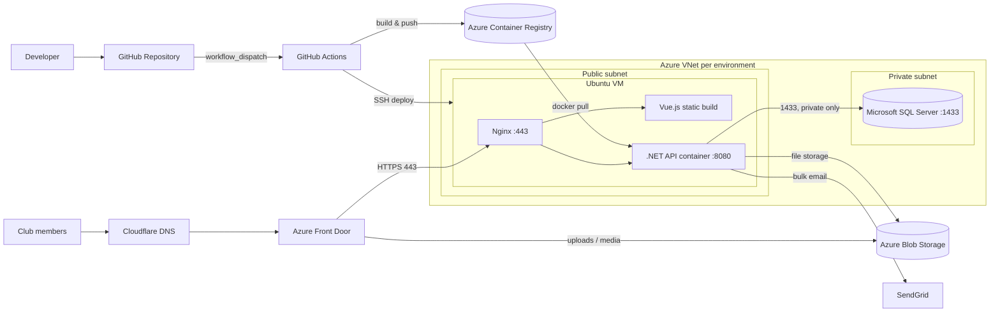

# Chat Platform (Hockey): CI/CD & Azure Deployment


The DevOps setup behind a real-time chat platform for hockey clubs. It runs as its own deployment, separate from the tennis platform ([azure-chat-platform-tennis](https://github.com/bilalahmad984/azure-chat-platform-tennis)). This repository contains the deployment pipelines and server configuration I designed and run. Application code is not included.

> **Two source repositories.** In the real project, the Vue.js frontend and the .NET backend live in **separate repositories**, each with its own pipelines. The `frontend/` and `backend/` folders here mirror those two repositories, so each folder's `.github/workflows` is exactly what runs in its own repo.

## What this project covers

- **Three environments:** `dev`, `stg` and `prod`, each with its own VM, secrets and container image
- **Containerized .NET backend:** built in GitHub Actions, pushed to **Azure Container Registry**, and run on an Ubuntu VM behind Nginx
- **Vue.js frontend built in Docker:** environment variables are injected from GitHub Secrets at build time, the build runs inside a container, and the static output is deployed to Nginx on the same VM
- **Azure Front Door** in front of the platform, routing traffic to the VM and serving uploaded files from **Azure Blob Storage**
- **Network isolation:** the VM sits in a public subnet and serves web traffic on HTTPS 443; **Microsoft SQL Server** runs in a private subnet with no internet access
- **Bulk email** through SendGrid, and **DNS** managed on Cloudflare
- **Server-side secrets:** the backend `.env` lives only on the VM and is passed to the container with `--env-file`

## Architecture



### Network and security

| Component | Placement | Inbound access |
|---|---|---|
| Ubuntu VM (Nginx, Vue.js build, .NET container) | Public subnet | Web traffic on HTTPS **443** |
| Microsoft SQL Server | Private subnet | **1433** only from the app VM |
| Azure Blob Storage | Azure managed | Served through Azure Front Door |

## Deployment flows

### Backend repository (.NET API)

1. **Build:** GitHub Actions builds the Docker image from the `ChatService` project.
2. **Push:** the image is pushed to Azure Container Registry as `chat-hockey-be-<env>:latest`.
3. **Deploy:** the pipeline connects to the environment's VM over SSH, logs in to ACR and pulls the new image.
4. **Replace:** any container already bound to port 8080 is removed, and the new container starts with `--restart always` and the server-side env file.
5. **Clean up:** dangling images are pruned to save disk space.

### Frontend repository (Vue.js)

1. **Configure:** a `.env` file is generated from GitHub Secrets for the target environment.
2. **Build in Docker:** the Vue app is built in a clean container (`--no-cache`), and the `dist` folder is copied out.
3. **Clean target:** the web root `/var/www/<env>-hockeyApp` on the VM is emptied.
4. **Deploy:** the new build is copied with `scp`, permissions are fixed, and Nginx is reloaded with no downtime.

## Environments

| Environment | Frontend repo workflow | Backend repo workflow | Web root | Image |
|---|---|---|---|---|
| Dev | `frontend-dev.yml` | `backend-dev.yml` | `/var/www/dev-hockeyApp` | `chat-hockey-be-dev` |
| Staging | `frontend-stg.yml` | `backend-stg.yml` | `/var/www/stg-hockeyApp` | `chat-hockey-be-stg` |
| Production | `frontend-prod.yml` | `backend-prod.yml` | `/var/www/prod-hockeyApp` | `chat-hockey-be-prod` |

All workflows run manually (`workflow_dispatch`), so each release is a deliberate step.

## Repository structure

```
.
├── frontend/                             # Mirrors the Vue.js frontend repository
│   └── .github/workflows/
│       └── frontend-{dev,stg,prod}.yml   # Build in Docker, deploy static files to Nginx
├── backend/                              # Mirrors the .NET backend repository
│   ├── .github/workflows/
│   │   └── backend-{dev,stg,prod}.yml    # Image to ACR, deploy container to the VM
│   └── .env.example                      # Backend env file layout on the VM
├── nginx/
│   └── hockey.conf.example                # Serves the SPA and proxies the API (shared VM)
├── docs/
│   └── github-secrets.md                 # Secrets for each repository and environment
└── README.md
```

## Setup

1. Per environment, create a VNet with a public and a private subnet, an Ubuntu VM in the public subnet (Docker and Nginx installed, HTTPS 443 open), and SQL Server in the private subnet reachable only from the VM.
2. Create an Azure Container Registry, a Blob Storage account and an Azure Front Door profile with the VM and storage account as origins.
3. Point the domain at Front Door from Cloudflare DNS.
4. Place the backend env file (see `backend/.env.example`) on the VM at `/opt/chat-hockey-<env>/.<env>-env`.
5. Configure Nginx using `nginx/hockey.conf.example`.
6. Add the secrets listed in [`docs/github-secrets.md`](docs/github-secrets.md) to each repository: frontend secrets to the frontend repo, backend and ACR secrets to the backend repo. The SSH secrets are needed in both.
7. Copy each folder's `.github/workflows` into its own repository, then run the workflow for the target environment from that repo's **Actions** tab.

## Planned improvements

- Sign in to Azure with **OIDC** (`azure/login`) and a managed identity instead of ACR username and password
- Tag images with the **commit SHA** instead of `latest`, so every deploy can be traced and rolled back
- Combine the per-environment files into one **reusable workflow** with the environment as an input
- Add a health check after the backend container starts, and fail the pipeline if it is not responding
- Use GitHub **Environments** with required reviewers for production

## Author

**Bilal Ahmad**: DevOps Team Lead, AWS & Azure
[LinkedIn](https://www.linkedin.com/in/Bilalahmad786) · [Upwork](https://www.upwork.com/freelancers/~01e0db54858a267270) · [GitHub](https://github.com/bilalahmad984)
